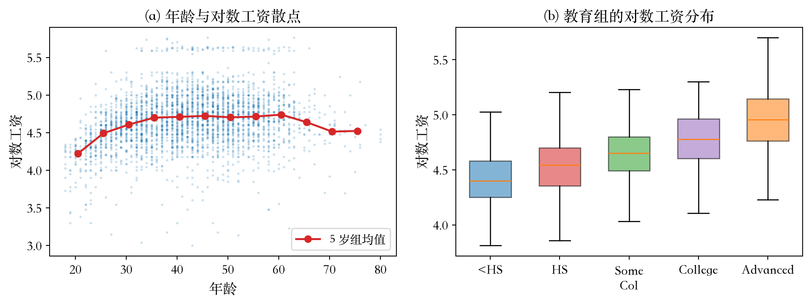
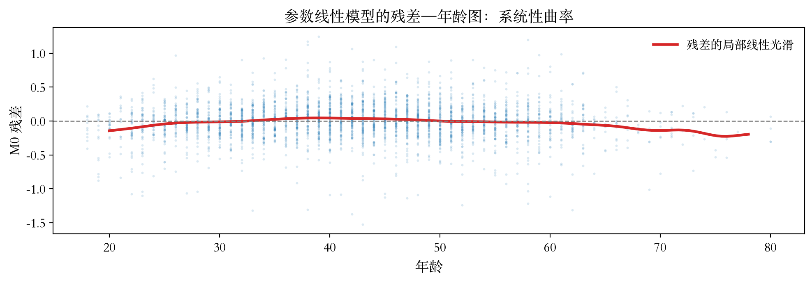
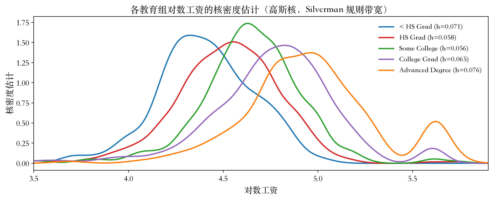
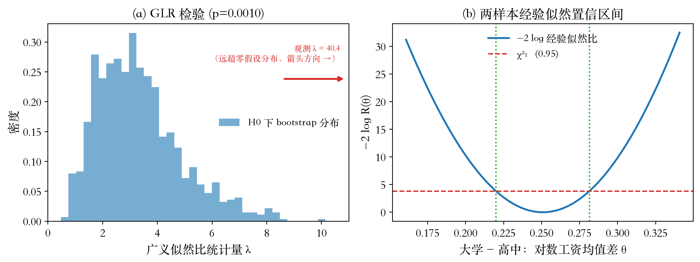
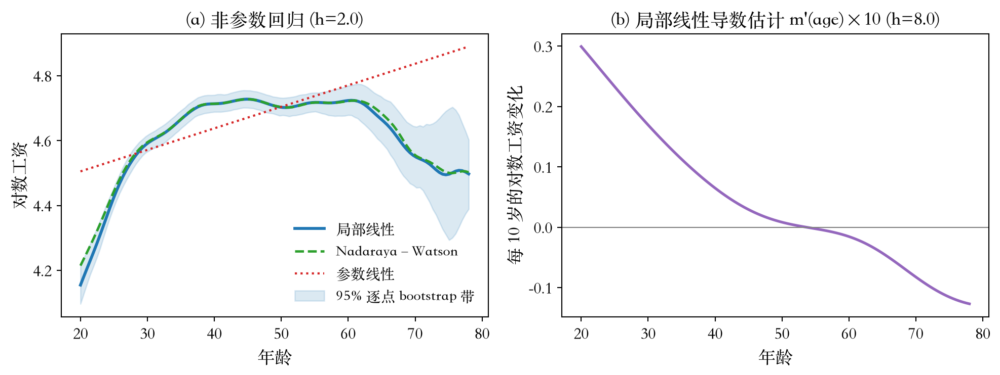
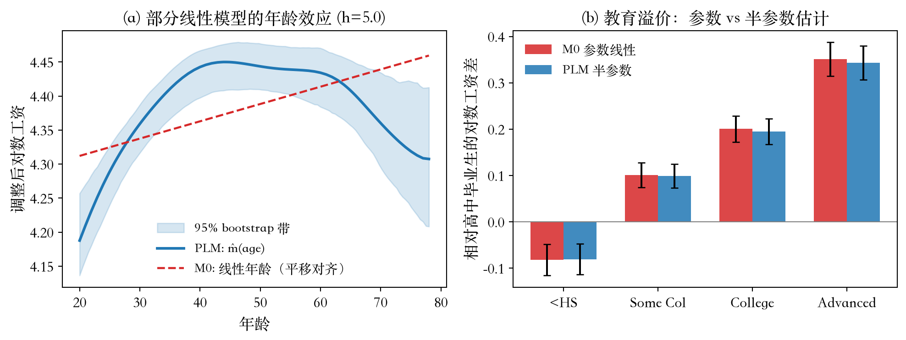
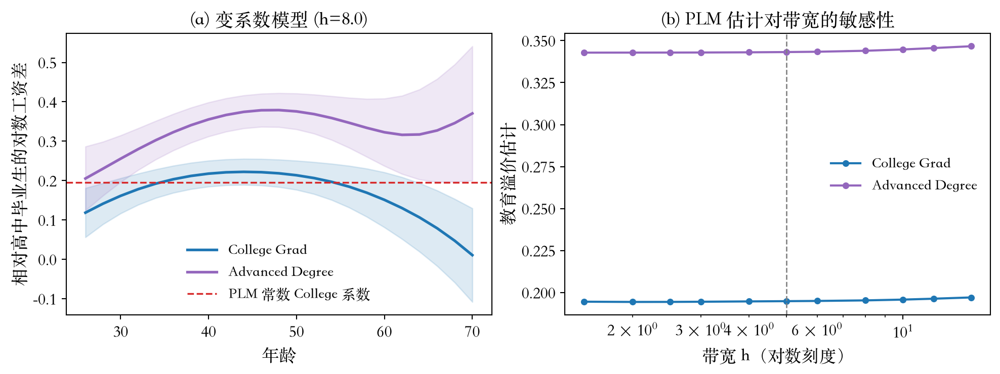

# 工资的年龄曲线：参数、非参数与半参数回归方法的比较研究

**——基于 ISLR Mid-Atlantic Wage 公开数据（n = 3000）**

*《非参和半参回归》课程期中论文　|　数据与代码：本 GitHub 仓库　|　分析语言：Python 3.13*

摘要：本文使用 ISLR 收录的美国中大西洋地区 3000 名男性工人工资数据，研究两个相互关联的问题：在控制教育、种族、婚姻、行业、健康与年份后，年龄对对数工资的条件均值效应是否为线性；若该效应非线性，沿用线性参数设定会在多大程度上扭曲教育回报的估计。论文依次使用三类方法。参数方法为含年龄一次、二次、三次项的多元线性回归（OLS 与 HC3 稳健标准误）、Ramsey RESET 设定检验与 Jarque–Bera 检验；非参数方法为高斯核密度估计、Kolmogorov–Smirnov / Mann–Whitney / Kruskal–Wallis 检验、Nadaraya–Watson 与局部线性核回归（交叉验证选带宽）、wild bootstrap 置信带及两样本经验似然置信区间；半参数方法为部分线性模型的 profile 核估计、广义似然比（GLR）检验、分段多项式（样条筛法）可加部分线性模型与变系数模型。主要结论是：年龄效应显著非线性且非单调，部分线性模型估计的工资在约 43.9 岁见顶，30 岁附近每增龄 10 岁对数工资上升 0.111，45 岁后转为接近 0 甚至为负，而线性参数模型给出恒定的 0.0254；GLR 统计量为 40.40，bootstrap p = 0.0010（B = 1000，达到该重复次数下的最小可达值），强烈拒绝线性设定。五折交叉验证预测均方误差由线性模型 0.078084 降至部分线性模型 0.076194，改善约 2.4%。与此形成对照的是，教育溢价估计对年龄设定相当稳健：大学毕业生相对高中毕业生的对数工资溢价由参数模型 0.2006 降至半参数模型 0.1948，配对 bootstrap 给出差值 0.0058（95% 区间 [0.0035, 0.0070]），统计上可检出但经济幅度很小。两样本经验似然给出未调整的大学—高中工资差 95% 区间 [0.2199, 0.2815]，与 Welch 区间几乎重合。论文最后讨论了工资变量离散结点对带宽选择的影响、全局设定检验的功效、边界效应与因果解释的局限。

关键词：部分线性模型；局部线性光滑；经验似然；广义似然比检验；带宽选择；年龄—工资曲线

## 1　引言

劳动经济学中经典的 Mincer 工资方程把对数工资对受教育程度和潜在工作经验（常以年龄近似）及其平方项作回归。经验平方项之所以被广泛采用，是因为实际数据中工资随年龄通常先快速上升、在中年趋于平缓、在高年龄段略有回落。然而，二次或三次多项式仍是一种全局参数假定：它要求年龄效应在整个 18–80 岁区间内由少数几个系数唯一决定。一旦真实曲线在局部（例如 20–30 岁的陡升段或 60 岁以后的下降段）偏离该假定，基于参数模型的年龄边际效应、预测乃至与年龄相关的其他系数都可能产生系统性偏差。

非参数回归令回归函数 m(·) 完全未知，仅由数据决定其形状，因而具备最强的稳健性；但其局部平均的本质使收敛速度随协变量维数迅速下降（维数灾难），且无法给出可解释的、具有 √n 收敛速度的参数估计。半参数模型在二者之间取得折中：对研究者主要关心、且可合理假定为线性影响的协变量（教育、种族、行业、健康等）保留有限维参数 β，对形状不确定的连续协变量（年龄）保留无穷维未知函数 m(·)。部分线性模型及其推广（可加部分线性模型、变系数模型、单指标模型）正是本课程的核心内容。

本文选取公开可得、样本量适中且协变量丰富的 ISLR Wage 数据，把三类方法放到同一问题、同一份样本上比较，具体回答以下四个问题：

（Q1）控制其他协变量后，年龄对对数工资的条件均值效应是否可以用线性函数刻画？若不能，其形状（峰值位置、边际增减）如何？

（Q2）线性设定对教育回报（各教育组相对高中毕业生的工资溢价）的估计是否造成实质偏误？半参数估计是否以牺牲效率换取稳健性？

（Q3）不同教育组的对数工资分布差异主要表现为位置平移，还是同时包含分布形状的变化？不依赖分布假定的经验似然推断与常规 t 推断是否一致？

（Q4）教育溢价是否随年龄变化？常数系数的部分线性模型是否只是便利的近似？

相较于单纯展示某一种方法，本文更关心三类方法在同一实证问题上的分工：参数模型提供清晰的解释与高效率的推断，非参数方法提供模型诊断与形状发现，半参数方法在保留可解释参数的同时修正设定错误，并用广义似然比检验给出形式化的模型比较。

## 2　数据、背景与描述统计

## 2.1　数据来源与背景

本文使用 R 包 ISLR 中的 Wage 数据集（Mid-Atlantic Wage Data）。按该数据集的 R 官方文档，数据由 Steve Miller（Inquidia Consulting，原 Open BI）依据 2011 年 3 月美国当前人口调查（Current Population Survey, CPS）补充调查手工整理，收录于 James、Witten、Hastie 与 Tibshirani (2013) 的教材《An Introduction to Statistical Learning》，并被 ISLR 第 7 章用于演示样条、阶梯函数与广义可加模型。本论文通过公开镜像 Rdatasets（GitHub: vincentarelbundock/Rdatasets，csv/ISLR/Wage.csv）获取原始 CSV，清洗后随代码一并存入仓库 data/ 目录，便于完全复现。

样本为美国中大西洋地区的 3000 名男性工人，观测年份覆盖 2003–2009，年龄 18–80 岁（共 61 个不同取值），无缺失值。原始数据含 11 个变量；其中 region 在样本内恒为 Middle Atlantic，无变异，故删除。工资 wage 的取值范围为 20.09–318.34（教材以千美元计），响应变量取 logwage = ln(wage)；经逐条核对，数据自带的 logwage 与 ln(wage) 的最大绝对偏差为 0，因此使用对数响应时不依赖工资的具体计量单位（单位变化只改变截距）。

一个值得注意的数据特征是：3 000 条工资记录中只有 508 个不同取值，出现次数最多的一个取值重复 120 次，说明工资被明显离散化（很可能由有限工资档位插值生成）。这一特征对连续型核密度估计的交叉验证带宽有直接影响，本文在 4.2 节专门讨论。

## 2.2　变量构造与描述统计

响应变量 Y = logwage。参数分量 Z 共 15 列：教育 4 个虚拟变量（基准组：高中毕业 HS Grad）、种族 3 个（基准：白人）、婚姻状况 4 个（基准：已婚）、行业（Information = 1）、健康状况（≥Very Good = 1）、是否拥有医疗保险（Yes = 1），以及中心化年份 year − 2006。非参数分量的协变量 U = age。参数模型中年龄按 (age − 40)/10 中心化缩放，系数解释为每增龄 10 岁的对数工资变化。

**表 1　各教育组的描述统计（响应变量为对数工资）**

| 教育水平 | 样本量 | 平均工资 | 平均 logwage | logwage 标准差 | 平均年龄 |
| --- | --- | --- | --- | --- | --- |
| < HS Grad | 268 | 84.1 | 4.398 | 0.271 | 41.8 |
| HS Grad | 971 | 95.8 | 4.521 | 0.292 | 42.2 |
| Some College | 650 | 107.8 | 4.636 | 0.307 | 40.9 |
| College Grad | 685 | 124.4 | 4.771 | 0.329 | 42.8 |
| Advanced Degree | 426 | 150.9 | 4.958 | 0.342 | 45.0 |

由表 1 可见，对数工资随教育程度单调递增，从高中以下组的 4.398 上升到研究生学位组的 4.958；同时组内标准差由 0.271 增至 0.342，提示高教育组的工资离散程度也更大。图 1(a) 的五岁分组均值已清楚显示年龄—工资曲线先升后平的形态，而叠加的线性拟合在两端明显偏离；图 1(b) 的箱线图显示教育组之间的位置差异与部分重叠。

*图 1　数据概览：(a) 年龄与对数工资散点及五岁组均值；(b) 五个教育组的对数工资箱线图*

## 3　统计方法

## 3.1　参数方法：线性与多项式回归

设 (Y_i, Z_i, U_i) 独立同分布，i = 1, …, n。基准参数模型为

> `(1)　Y_i = α + γ · (U_i − 40)/10 + Z_i' β + ε_i,　E(ε_i | Z_i, U_i) = 0,　Var(ε_i) = σ²`

在高斯误差假定下 OLS 即为极大似然估计；推断使用 HC3 异方差稳健协方差矩阵与 Wald 型置信区间。为放宽年龄设定，依次加入年龄的二次、三次项得到 M1、M2，并用 F 检验考察高次项的联合显著性。模型比较使用 R²、调整 R²、AIC、BIC 与五折交叉验证预测均方误差。设定诊断包括：Ramsey RESET 检验（把拟合值的二次、三次项加入原模型作 F 检验）、Jarque–Bera 残差正态性检验，以及残差对年龄的局部线性光滑图。

## 3.2　非参数方法

（1）核密度估计。对一组观测 X_1, …, X_m，高斯核密度估计与 Silverman 规则带宽为

> `(2)　f_hat(x) = (1/m) Σ_j K_h(x − X_j),　K_h(t) = φ(t/h)/h,　h_S = 0.9 · min(s, IQR/1.349) · m^(−1/5)`

带宽另以最小二乘交叉验证（LSCV）作为对照：CV(h) = ∫ f_hat² − (2/m) Σ_i f_hat_{h,−i}(X_i)。核回归采用 Nadaraya–Watson 估计与一阶局部多项式（局部线性）估计

> `(3)　m_hat_NW(u) = Σ_i K_h(U_i − u) Y_i / Σ_i K_h(U_i − u)`

> `(4)　m_hat_LL(u) = a_hat,　(a_hat, b_hat) = argmin_{a,b} Σ_i K_h(U_i − u) [Y_i − a − b(U_i − u)]²`

局部线性估计在边界处自动修正一阶偏差且保持设计自适应性，其加权最小二乘解同时给出导数估计 b_hat = m_hat'(u)。带宽由五折交叉验证在 1.5–15 岁的网格上选取；导数估计对带宽更敏感，另取较大带宽 h = 8。不确定性用 wild bootstrap（残差乘以 Rademacher 变量，固定设计）给出逐点 95% 置信带，并用 max-|t| 校准量 3.09（对应正态近似的 1.96）说明同时置信带更宽。

（2）分布比较的非参数检验。用两样本 Kolmogorov–Smirnov 检验与 Mann–Whitney 秩和检验比较大学毕业生与高中毕业生，用 Kruskal–Wallis 检验比较五个教育组；为区分「位置平移」与「形状变化」，进一步对去均值后的两样本再做 KS 检验。

（3）经验似然。对两独立样本 X（大学组）与 Y（高中组），令 θ = μ_X − μ_Y，在约束 Σ p_i = 1、Σ q_j = 1、Σ p_i X_i − Σ q_j Y_j = θ 下最大化 ∏ p_i ∏ q_j，得经验似然比 R(θ)。按 Owen (1988, 1990) 与 Jing (1995) 的 Wilks 定理，

> `(5)　−2 log R(θ_0) → χ²_1,　置信域 = { θ : −2 log R(θ) ≤ χ²_1(0.95) }`

本文用拉格朗日对偶求解权重 p_i = 1/(a + λ X_i)、q_j = 1/(b − λ Y_j)，并对 θ 逐点求根得到置信区间。经验似然不假定总体分布、不需要显式估计方差，且置信域形状由数据决定，可与 Welch t 区间相互印证。

## 3.3　半参数方法

（1）部分线性模型（PLM）。设定

> `(6)　Y_i = Z_i' β + m(U_i) + ε_i,　E(ε_i | Z_i, U_i) = 0`

其中 β 为有限维兴趣参数，m(·) 为完全未知的光滑函数。采用 Robinson (1988) 的「去均值」思想与 Speckman (1988) 的 profile 最小二乘：记 S 为局部线性光滑矩阵（S v 在 U_i 处给出 v 对 U 的局部线性拟合），令 Z_tilde = (I − S) Z、ỹ = (I − S) Y，则

> `(7)　β_hat = (Z_tilde' Z_tilde)^(−1) Z_tilde' ỹ,　m_hat(u) = S (Y − Z β_hat)(u),　λ_n = (n/2) log(RSS_0 / RSS_1)`

在 h → 0、n h → ∞ 等正则条件下 β_hat 具有 √n 相合性与渐近正态性，非参数分量只以较慢的速度收敛，这正是半参数模型相对纯非参数模型的关键优势。标准误同时给出 sandwich 型渐近值与 wild bootstrap 百分位区间；带宽由五折交叉验证的样本外预测误差选取，并在 1.5–15 岁范围内做敏感性分析。

（2）广义似然比检验（GLR）。为正式检验 H0: m(u) = a + b u（即参数线性设定）对 H1: m(·) 为任意光滑函数，采用 Fan、Zhang 与 Zhang (2001) 的广义似然比统计量 (7) 式右端，其中 RSS_0 为参数模型残差平方和、RSS_1 为 PLM 的 profile 残差平方和。由于非参数拟合带来的自由度增益服从非标准的 Wilks 现象，本文用 wild bootstrap 在原假设下重抽样 1000 次校准零分布，p 值按「1 加上零分布中不小于观测值的次数、再除以 B + 1」计算。

（3）分段多项式（样条筛法）可加部分线性模型。作为核方法的独立对照，用三次截断幂基 (a, a², a³, (a − κ)_+³，节点 κ ∈ {−1, 0, 1, 2, 3}) 逼近 m(age)，并用年份虚拟变量吸收年份效应，得到可加部分线性模型 Y = Z'β + m1(age) + m2(year) + ε。该方法把无穷维 nuisance 参数用有限维基展开（sieve）替代，可直接用 OLS 估计，对应课程讲义中「分段多项式法」与「可加部分线性模型」两节。

（4）变系数模型。为检验教育溢价是否随年龄变化，拟合 Y_i = X_i' β(U_i) + ε_i，在每个年龄 u 处用核权重解加权局部线性最小二乘，得到 β_hat(u) 及其 sandwich 标准误（Hastie & Tibshirani, 1993；Fan & Zhang, 1999）。此处的 X 包含截距与全部 Z 列。

## 3.4　计算实现与可复现性

全部计算使用 Python 3.13（NumPy、SciPy、statsmodels、Matplotlib、reportlab），随机种子固定为 20261120；置信带与系数区间使用 600 次 wild bootstrap，GLR 校准使用 1000 次；交叉验证统一采用相同的五折划分。分析脚本 code/analysis.py 一次性输出全部表格、图形与 results.json；排版脚本 code/make_paper.py 从 results.json 读取数值生成本文，因此文中每个数字都与代码输出严格一致。

## 4　实证结果

## 4.1　参数模型结果与设定诊断

**表 2　模型拟合与样本外预测比较（AIC/BIC 中 PLM 的自由度按 p + tr(S) 近似）**

| 模型 | RSS | R² | 有效自由度 | AIC | BIC | 五折 CV MSE |
| --- | --- | --- | --- | --- | --- | --- |
| M0 (线性年龄) | 231.85 | 0.3752 | 17.00 | -7646.9 | -7544.8 | 0.078084 |
| M1 (二次年龄) | 226.34 | 0.3900 | 18.00 | -7717.0 | -7608.9 | 0.076245 |
| M2 (三次年龄) | 225.81 | 0.3915 | 19.00 | -7722.0 | -7607.9 | 0.076125 |
| PLM (核光滑) | 225.68 | 0.3918 | 21.76 | -7718.2 | -7587.5 | 0.076194 |
| Sieve-APLM (样条) | 224.95 | 0.3938 | 30.00 | -7711.5 | -7531.3 | 0.076592 |

基准线性模型 M0 的 R² = 0.3752，调整 R² = 0.3718，残差标准差 σ_hat = 0.2788；年龄系数为 0.0254，即模型声称无论处于哪个年龄段，每增龄 10 岁对数工资都恒定上升约 2.5%。在 M2 中对年龄二次、三次项的联合 F 检验为 F = 37.15，p = 1.15e-16，强烈拒绝线性设定；加入二次项后 RSS 由 231.85 降至 226.34，五折 CV MSE 由 0.078084 降至 0.076245。

有趣的是，Ramsey RESET 检验却未能拒绝 M0（F = 0.806，p = 0.447）。RESET 把拟合值的幂加入模型，检验的是「沿 ŷ 方向」的遗漏非线性；当设定错误集中在某一个协变量（年龄）而该变量在拟合值中的占比有限时，这种全局、无方向的检验功效很低。相比之下，针对年龄的 F 检验与 4.5 节的 GLR 检验功效高得多。这一对比说明：不拒绝设定检验不等于设定正确，参数模型的诊断必须结合残差—协变量光滑图等有方向的工具。

图 7 给出 M0 残差对年龄的局部线性光滑：残差在 20–30 岁系统性为负、40–60 岁系统性为正、70 岁后再度转负，光滑曲线取值范围约 [-0.226, 0.045]，呈现清晰的 S 形结构，正是年龄三次项所捕捉的形态。此外 Jarque–Bera 统计量为 1109.6（p ≈ 0），拒绝残差正态性，这为后文采用 wild bootstrap、秩检验与经验似然等非参数推断提供了动机。

*图 7　参数线性模型 M0 的残差—年龄图与局部线性光滑（虚线为零）*

## 4.2　工资分布：核密度估计、秩检验与经验似然

图 2 给出五个教育组对数工资的高斯核密度估计。Silverman 规则带宽介于 0.056 与 0.076 之间。曲线整体随教育程度右移，且高教育组右尾更厚，与表 1 中均值、标准差同步上升一致。

需要如实指出一个方法上的陷阱：对每组做 LSCV 时，最优带宽全部落在搜索网格下界 0.03，密度曲线会出现大量虚假尖峰。原因在于工资只有 508 个不同取值，大量完全相同的观测使「留一法」密度 f_hat_{h,−i}(X_i) 在 h → 0 时被同值观测的核权重人为抬高，CV(h) 因而退化为单调偏向极小带宽。这说明 LSCV 隐含的「连续无结点」假定在本数据上不成立；因此本文主分析采用 Silverman 规则带宽，并把 LSCV 的失效作为数据离散性的诊断记录。若坚持使用交叉验证，应先对工资作微小抖动（jitter）或改用适用于离散数据的核。

*图 2　各教育组对数工资的核密度估计（高斯核，Silverman 规则带宽）*

分布检验方面：大学毕业生与高中毕业生的 KS 统计量 D = 0.385，p = 1.24e-53；Mann–Whitney 检验 p = 3.11e-62；五组 Kruskal–Wallis 统计量 χ² = 767.0，p = 1.05e-164。这些结果说明教育组之间确实存在显著的分布差异。但将两组各自去均值后再做 KS 检验，D 降至 0.048，p = 0.311，不再拒绝分布相同：换言之，教育带来的工资分布差异在本数据中主要是一次位置平移，标准差从 0.270 增至 0.342 所提示的离散度变化尚不足以被 KS 检验检出。

对未控制协变量的大学—高中对数工资差 θ_hat = 0.2508（约 28.5%），两样本经验似然给出 95% 置信区间 [0.2199, 0.2815]，Welch t 区间为 [0.2200, 0.2815]，两者几乎重合。在样本量 685 与 971 之下，经验似然比统计量的分布已很接近 χ²_1，体现了 Wilks 现象；同时它无需正态假定与方差估计，是对 t 推断的有益交叉验证。值得注意的是，这一未调整差距（0.251）明显大于 4.4 节控制协变量后的大学溢价（0.195），说明年龄构成、行业、婚姻等因素解释了约四分之一的表观教育工资差。

*图 5　非参数与半参数推断：(a) GLR 统计量的 bootstrap 零分布；(b) 两样本经验似然比函数与 95% 置信区间*

## 4.3　非参数回归：年龄—工资曲线的形状

对 Y 关于 U = age 的一维非参数回归，五折交叉验证在 11 个候选带宽中选出 h = 2.0 岁（CV 曲线在该点附近平坦，h = 1.5 与 2.5 的 CV 值分别为 0.109646 与 0.109602）。图 3(a) 中局部线性与 Nadaraya–Watson 估计几乎重合，仅在两端略有差异，体现局部线性对边界偏差的修正；两者都清楚显示先快速上升、中年走平、老年回落的倒 U 形，峰值约在 44.9 岁，与叠加的参数直线形成定性冲突。用较大带宽 h = 8.0 估计导数（图 3(b)），30 岁附近每增龄 10 岁对数工资约上升 0.169，60 岁附近为 -0.015：年龄的边际回报随年龄单调下降并转负，这与 Mincer 方程中经验平方项的直觉一致，但不需要预设二次函数形式。

图 3(a) 的浅色带为 wild bootstrap 逐点 95% 区间。在 70 岁以上样本稀疏、带宽内有效观测减少，置信带明显变宽，曲线末端的局部波动不宜作实质解释；这也是所有局部光滑方法共有的边界效应。若要求整条曲线的同时覆盖，max-|t| 校准的临界值约为 3.09（而非 1.96），置信带还需相应放宽。

*图 3　非参数回归：(a) 局部线性、NW 与参数线性拟合及逐点置信带；(b) 局部线性导数估计*

## 4.4　半参数部分线性模型：修正年龄设定后的教育回报

部分线性模型 Y = Z'β + m(age) + ε 的交叉验证带宽为 h = 5.0 岁，光滑矩阵迹 tr(S) = 6.76，profile 残差平方和 225.68（M0 为 231.85），R² = 0.3918，σ_hat = 0.2753。图 4(a) 中 m_hat(age) 在约 43.9 岁达到峰值：30 岁时每增龄 10 岁对数工资上升 0.111，45 岁为 -0.004，60 岁为 -0.011。与 4.3 节的边际曲线相比，控制教育、行业等协变量后的条件年龄效应幅度更小，但「先升后平再略降」的定性结论不变——线性设定给出的恒定 +0.025 无法描述任何一段真实生命周期。

**表 3　教育溢价估计（相对高中毕业生；括号内为稳健/ bootstrap 标准误）**

| 教育水平 | M0 线性 | M1 二次 | M2 三次 | PLM 核光滑 | 样条筛法 |
| --- | --- | --- | --- | --- | --- |
| 高中以下 | -0.0821 (0.0171) | -0.0798 (0.0170) | -0.0806 (0.0170) | -0.0807 (0.0169) | -0.0801 (0.0171) |
| 部分大学 | 0.1009 (0.0138) | 0.1000 (0.0136) | 0.0995 (0.0136) | 0.0992 (0.0132) | 0.0983 (0.0136) |
| 大学毕业 | 0.2006 (0.0145) | 0.1958 (0.0143) | 0.1948 (0.0143) | 0.1948 (0.0141) | 0.1957 (0.0144) |
| 研究生学位 | 0.3512 (0.0186) | 0.3452 (0.0186) | 0.3439 (0.0186) | 0.3432 (0.0187) | 0.3434 (0.0187) |

表 3 的核心信息是：三类方法给出的教育溢价高度一致。以大学毕业生为例，M0 估计 0.2006（HC3 标准误 0.0145），PLM 估计 0.1948（wild bootstrap 标准误 0.0141，95% 区间 [0.1667, 0.2236]），样条筛法给出 0.1957。半参数估计并未因引入无穷维 nuisance 参数而明显损失效率：两者的标准误几乎相同，这与 Robinson (1988) 关于 β_hat 具有 √n 相合性的理论一致。换算为工资比例，大学毕业溢价约 21.5%，研究生学位溢价约 40.9%。

**表 4　参数模型减去半参数模型的教育溢价差（同一批 wild bootstrap 样本的配对差）**

| 教育水平 | 差值 M0 − PLM | bootstrap 标准误 | 95% 置信区间 | 是否显著 |
| --- | --- | --- | --- | --- |
| 高中以下 | -0.0014 | 0.0009 | [-0.0034, 0.0002] | 否 |
| 部分大学 | 0.0017 | 0.0007 | [0.0002, 0.0028] | 是 |
| 大学毕业 | 0.0058 | 0.0009 | [0.0035, 0.0070] | 是 |
| 研究生学位 | 0.0080 | 0.0011 | [0.0051, 0.0095] | 是 |

由于两种估计基于同一份样本、彼此高度相关，直接比较各自的边际标准误会严重夸大差值的不确定性。表 4 改用配对 bootstrap：在每个重抽样样本上同时拟合 M0 与 PLM 并取差，从而正确刻画差值的抽样分布。结果显示线性年龄设定使大学与研究生溢价分别高估约 0.0058 与 0.0080 个对数点，其 95% 区间不含 0，统计上可检出；但相对 0.195 与 0.343 的估计水平，偏误幅度不足 3%，经济意义很小。一个合理解释是：年龄与各教育虚拟变量的相关很弱（|r| ≤ 0.091），因此被误设的年龄函数几乎与教育变量正交，设定误差主要被截距和 m(·) 吸收；仅研究生学位与年龄有弱正相关（r = 0.091），加上线性模型高估了职业生涯晚期的工资增长，才使其溢价出现可检出的轻微上偏。

*图 4　部分线性模型：(a) 年龄效应 m_hat(age) 与 bootstrap 置信带；(b) 参数与半参数教育溢价对比*

## 4.5　广义似然比检验：线性设定是否被拒绝

**表 5　设定检验与分布检验汇总**

| 检验 | 统计量 | p 值 |
| --- | --- | --- |
| Ramsey RESET (M0) | 0.806 | 0.4466 |
| Jarque-Bera (M0 残差) | 1109.612 | 1.12e-241 |
| F 检验：年龄二/三次项 (M2) | 37.155 | 1.15e-16 |
| KS：大学 vs 高中 (对数工资) | 0.385 | 1.24e-53 |
| KS：去均值后（形状差异） | 0.048 | 0.3107 |
| Mann-Whitney：大学 vs 高中 | 492086.000 | 3.11e-62 |
| Kruskal-Wallis：五教育组 | 767.048 | 1.05e-164 |
| GLR：H0 年龄效应线性 | 40.404 | 0.0010 |

GLR 统计量 λ_n = (n/2) log(RSS_0/RSS_1) = 40.40。在 H0（年龄效应线性）下 1000 次 wild bootstrap 得到的零分布均值为 3.34、95% 分位数为 6.42，最大值仍远小于观测值，因此 p = (1 + 0)/(1000 + 1) = 0.0010，即 p ≤ 0.001；线性设定被明确拒绝。图 5(a) 显示零分布集中在 0–8 之间，观测值位于其右侧很远的位置（图中以箭头标注）。与 4.1 节的 F 检验相比，GLR 的备择假设是任意光滑函数而非特定的多项式方向，因而在真实曲线形状未知时更具一般性；与 RESET 相比，它又具有明确的方向（年龄效应），在功效上明显占优。三者结论合起来说明：本数据中的设定错误既真实存在，又需要恰当的检验才能发现。

## 4.6　稳健性分析与拓展模型

带宽敏感性：把 PLM 的带宽从 h = 1.5 变动到 15，大学毕业溢价仅在 0.1945–0.1971 之间变化，研究生溢价在 0.3429–0.3467 之间变化（图 6(b)），远小于抽样标准误；而 profile RSS 从 224.91 上升到 227.74，说明带宽主要影响曲线形状而非参数估计。这一「参数分量对带宽不敏感」的现象正是半参数估计实用价值的重要体现。

样条筛法可加部分线性模型给出大学毕业溢价 0.1957、研究生溢价 0.3434，与核光滑 PLM 几乎相同，说明结论不依赖于「核光滑 vs 样条基」这一具体非参数实现方式。不过其五折 CV MSE = 0.076592 略高于 PLM 的 0.076194，反映 30 个基函数带来的轻微过拟合。

变系数模型（图 6(a)，h = 8.0）提示常数 β 只是近似：大学毕业溢价在 30 岁约 0.161（标准误 0.023）、在 40 岁前后升至约 0.21、60 岁约 0.151（标准误 0.036），70 岁附近进一步下降；研究生学位溢价则在中年后偏高。考虑到局部样本量下降导致两端置信带明显变宽，此结果应视为探索性证据，但它提示「教育回报随职业生涯阶段变化」是值得后续用纵向数据检验的假设，也说明可加部分线性模型、变系数模型等更灵活的半参数结构在本课程框架内有实际用武之地。

最后，从纯预测角度看（表 2），参数三次模型 M2 的五折 CV MSE = 0.076125，与 PLM 的 0.076194 基本相同，甚至略优；AIC 也最偏向 M2。这一结果并非半参数方法的失败，而是提示：当真实曲线恰好能被低阶多项式良好近似时，参数模型因自由度更少而更有效率。半参数方法的价值在于研究者事先并不知道这一点，它既能自动发现曲线形状、给出对设定错误的正式检验，又能在形状复杂时避免参数模型的结构性偏误；两种方法互为补充而非互相替代。

*图 6　稳健性分析：(a) 变系数模型给出的教育溢价随年龄变化；(b) PLM 参数估计的带宽敏感性*

## 5　结论与讨论

## 5.1　主要结论

（1）年龄效应显著非线性、非单调。局部线性与部分线性估计一致表明对数工资在 44 岁前后见顶，青年期边际回报很高、中年趋零、老年略负；参数线性模型给出的恒定正向斜率在曲线的两端都产生系统性误导。针对年龄的 F 检验（p ≈ 1.15e−16）与 GLR 检验（p ≤ 0.001）均拒绝线性设定，而 RESET 检验（p = 0.447）却未能拒绝，说明设定检验的方向与功效十分关键。

（2）半参数模型在保留可解释参数的同时显著改善拟合与预测：R² 由 0.3752 提高到 0.3918，五折 CV MSE 由 0.078084 降到 0.076194（约 2.4%），且无须预先指定年龄的多项式阶数。

（3）教育溢价对年龄设定稳健。大学与研究生溢价分别为 0.1948 与 0.3432（相对高中毕业生），参数模型仅轻微高估 0.0058 与 0.0080 个对数点；配对 bootstrap 表明差异统计显著但经济幅度不足 3%。PLM 中 β 的标准误与参数模型相当，验证了半参数兴趣参数的 √n 有效性。

（4）教育组的工资分布差异主要是位置平移（去均值后 KS 检验 p = 0.311），经验似然与 Welch 区间几乎一致；未调整工资差 0.251 大于调整后溢价 0.195，说明控制协变量对解释教育工资差不可或缺。

（5）方法分工上，参数模型适合高效推断与清晰解释，非参数模型适合诊断与形状发现，半参数模型在二者之间提供「可解释参数 + 灵活 nuisance 函数」的折中，并可用 GLR、经验似然、bootstrap 等工具完成形式化推断。

## 5.2　局限与进一步讨论

第一，因果解释的限制。数据是横截面观测（不同工人、不同年份的混合），既没有控制不可观测的能力、家庭背景与职业匹配质量，也无法区分年龄效应、出生队列效应与时期效应；教育变量还可能受自选择影响。因此本文的「教育溢价」应理解为条件相关而非教育的因果回报（Card, 1999），年龄曲线也不应直接解读为个体生命周期的工资轨迹。此外，若同一工人在多个年份被重复观测，误差独立性假定会被违反，需要聚类稳健标准误或单指标混合效应模型（课程第 14 讲）来刻画组内相关。

第二，数据的离散性与分布假定。工资只有 508 个不同取值，使 LSCV 带宽选择失效；Jarque–Bera 检验也强烈拒绝残差正态性。本文相应采用 Silverman 规则带宽、HC3 稳健协方差、wild bootstrap 与经验似然，但 GLR 的 bootstrap 校准与经验似然的 Wilks 定理仍依赖一定的正则条件，在结点密集、异方差明显时值得用更细致的模拟评估其有限样本表现。

第三，局部光滑的固有代价。70 岁以上观测稀疏，m_hat(age) 的置信带显著变宽，边界处的结论应谨慎陈述；导数估计对带宽比函数估计更敏感，本文另用较大带宽单独估计。自适应带宽、样条或局部似然可部分缓解，但无法消除数据本身的信息不足。

第四，维数灾难与结构假定。本文只对一维年龄作非参数处理，其余协变量均设为线性；若多个连续协变量同时具有未知形状，纯非参数回归不可行，需要可加模型、可加部分线性模型、单指标模型或变系数模型等结构假定（课程第 8–13 讲）。图 6(a) 的探索性结果也提示，至少教育溢价可能存在随年龄变化的交互结构。

第五，可拓展的方向：分位数部分线性模型可刻画工资分布不同分位上的教育回报差异；单指标模型可把多维协变量压缩为一维指数；对含缺失或删失的工资/就业时长数据，可使用课程中加权校正的经验似然与逆概率加权方法。

数据与代码可用性：清洗后的数据 data/Wage.csv、完整分析代码 code/analysis.py、排版代码 code/make_paper.py、全部表格与图形 results/ 均存于本 GitHub 仓库；执行 python3 code/analysis.py 再执行 python3 code/make_paper.py 即可从头复现本文全部数值与图表。

## 6　AI 工具的使用说明

按照课程要求，本文如实说明 AI 工具的使用情况。写作与阐述、编程与其他辅助任务中都使用了 AI 工具，具体如下。

（1）使用的工具。本文使用 CodeBuddy（由腾讯混元大模型驱动的 AI 编程助手）作为主要 AI 工具，在本地 IDE 中完成资料检索建议、代码编写与调试、文本起草、图表排版及校对；未使用其它生成式 AI 服务，未使用 AI 生成图像素材或虚构实验结果。

（2）选题与资料。AI 协助比对若干公开数据集（R/Python 内置数据与公开镜像），并根据课程讲义《非参和半参回归》的目录建议了「参数—非参数—半参数三类方法对比」的研究框架；AI 还协助检索并核对了 Wage 数据集的 R 官方文档、ISLR 教材出处与 Rdatasets 镜像地址。数据源、研究问题与最终方法清单由本人（作者）审定，并逐一核对了文档原文。

（3）编程与计算。AI 编写并调试了 code/analysis.py 中的核光滑矩阵、两样本经验似然的对偶求解、profile 最小二乘、wild bootstrap、GLR 的 bootstrap 校准、样条筛法与变系数模型等实现，以及 code/make_paper.py 的 PDF 排版。本人运行了全部代码，检查了输出结果的合理性（例如经验似然区间与 Welch 区间的一致性、EL 与 bootstrap 的收敛、带宽敏感性、残差平方和的比较、图形与表格的可读性），并对发现的异常（如 LSCV 因工资结点失效、RESET 与 F 检验结论不一致）逐一追查原因并在正文中如实报告。所有代码均随仓库公开，可独立复现；AI 未参与生成任何数据或数值结果，全部数字来自代码实算。

（4）写作与阐述。AI 依据 results/results.json 中的实际输出起草了中文论文初稿，包括方法部分的公式叙述、结果部分的表格整理与结论部分的讨论要点；排版脚本以 f-string 从结果文件读取数值，避免人工抄写错误。本人审阅并修改了全文结构、措辞与结论强度，确认所有判断均由数据支持，并对 5.2 节的局限性讨论作了补充。摘要、结论与 AI 使用说明由本人最终定稿。

（5）图表与校对。AI 使用 Matplotlib 生成全部 7 幅图、使用 reportlab 生成 PDF，并协助做术语一致性、标点、编号、交叉引用与中文字体的校对；本人逐页检查了 PDF 版面与图形标注。

（6）演讲材料。AI 协助起草了不超过 3 分钟的论文讲稿与配套幻灯片（presentation/ 目录）；演讲内容由本人核对后使用。

（7）学术诚信声明。本文所有引用文献均为真实公开文献，题名、期刊、卷期与年份经本人核对；未把 AI 列为作者，未引用 AI 生成的虚假文献，未伪造数据、结果或检验结论。AI 工具承担的是编程、检索、起草与校对性质的辅助工作，本文的研究设计、方法选择、结果解释与全部责任由本人承担。若课程对 AI 使用另有更严格的申报格式，以课程要求为准。

## 参考文献

### 参考文献

[1] James G., Witten D., Hastie T., Tibshirani R. An Introduction to Statistical Learning with Applications in R[M]. New York: Springer, 2013.（Wage 数据集收录出处）
[2] ISLR::Wage, Mid-Atlantic Wage Data[DB/OL]. R 包文档与 Rdatasets 公开镜像, https://github.com/vincentarelbundock/Rdatasets, 访问日期 2026-11-20.（原始数据文档：Steve Miller 依据 2011 年 3 月 CPS 补充调查整理）
[3] Mincer J. Schooling, Experience, and Earnings[M]. New York: NBER / Columbia University Press, 1974.
[4] Robinson P. M. Root-N-consistent semiparametric regression[J]. Econometrica, 1988, 56(4): 931–954.
[5] Speckman P. Kernel smoothing in partial linear models[J]. Journal of the Royal Statistical Society: Series B, 1988, 50(3): 413–436.
[6] Härdle W., Liang H., Gao J. Partially Linear Models[M]. Heidelberg: Physica-Verlag, 2000.
[7] Nadaraya E. A. On estimating regression[J]. Theory of Probability and Its Applications, 1964, 9(1): 141–142.
[8] Watson G. S. Smooth regression analysis[J]. Sankhyā: Series A, 1964, 26(4): 359–372.
[9] Fan J., Gijbels I. Local Polynomial Modelling and Its Applications[M]. London: Chapman & Hall, 1996.
[10] Silverman B. W. Density Estimation for Statistics and Data Analysis[M]. London: Chapman & Hall, 1986.
[11] Owen A. B. Empirical likelihood ratio confidence intervals for a single functional[J]. Biometrika, 1988, 75(2): 237–249.
[12] Owen A. B. Empirical likelihood ratio confidence regions[J]. The Annals of Statistics, 1990, 18(1): 90–120.
[13] Qin J., Lawless J. Empirical likelihood and general estimating equations[J]. The Annals of Statistics, 1994, 22(1): 300–325.
[14] Jing B.-Y. Two-sample empirical likelihood method[J]. Statistics & Probability Letters, 1995, 24(4): 315–319.
[15] Fan J., Zhang C., Zhang J. Generalized likelihood ratio statistics and Wilks phenomenon[J]. The Annals of Statistics, 2001, 29(1): 153–193.
[16] Efron B. Bootstrap methods: another look at the jackknife[J]. The Annals of Statistics, 1979, 7(1): 1–26.
[17] Wu C. F. J. Jackknife, bootstrap and other resampling methods in regression analysis[J]. The Annals of Statistics, 1986, 14(4): 1261–1295.
[18] Hastie T. J., Tibshirani R. J. Generalized Additive Models[M]. London: Chapman & Hall, 1990.
[19] Hastie T., Tibshirani R. Varying-coefficient models[J]. Journal of the Royal Statistical Society: Series B, 1993, 55(4): 757–796.
[20] Fan J., Zhang W. Statistical estimation in varying coefficient models[J]. The Annals of Statistics, 1999, 27(5): 1491–1518.
[21] Ramsey J. B. Tests for specification errors in classical linear least-squares regression analysis[J]. Journal of the Royal Statistical Society: Series B, 1969, 31(2): 350–371.
[22] Card D. The causal effect of education on earnings[M] // Ashenfelter O., Card D. Handbook of Labor Economics, Vol. 3A. Amsterdam: Elsevier, 1999: 1801–1863.
[23] 罗珊. 非参和半参回归（课程讲义 Chapter5）[Z]. 上海交通大学数学科学学院, 课程讲义（未标注出版年份）.（核密度估计、部分线性模型、经验似然、可加模型与变系数模型等方法依据）

## 附录　变量编码与文件清单

附录 A　变量编码：响应 Y = logwage = ln(wage)；U = age；Z 依次为 教育（< HS Grad, Some College, College Grad, Advanced Degree；基准 HS Grad）、种族（Black, Asian, Other；基准 White）、婚姻（Never Married, Widowed, Divorced, Separated；基准 Married）、jobclass = 1(Information)、health = 1(≥Very Good)、health_ins = 1(Yes)、year − 2006。参数模型另含截距与 (age − 40)/10 的一至三次幂。

附录 B　仓库文件：data/Wage_raw.csv（原始下载）、data/Wage.csv（清洗后分析数据）、data/SOURCES.md（数据来源与清洗说明）、code/analysis.py（全部统计计算）、code/make_paper.py（论文排版）、code/requirements.txt（依赖版本）、results/（表格、图形、results.json）、paper/论文.pdf 与 论文.md、presentation/（3 分钟讲稿与幻灯片）、submission/（Canvas 提交 zip）。
